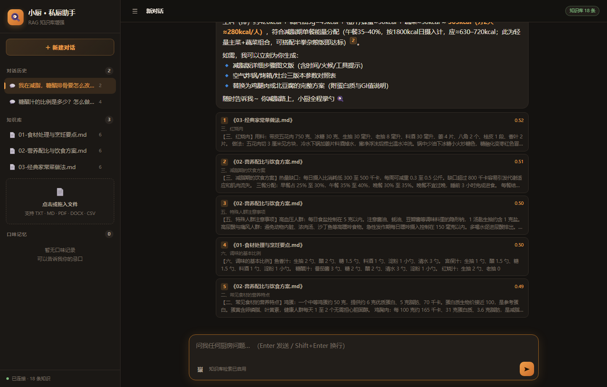
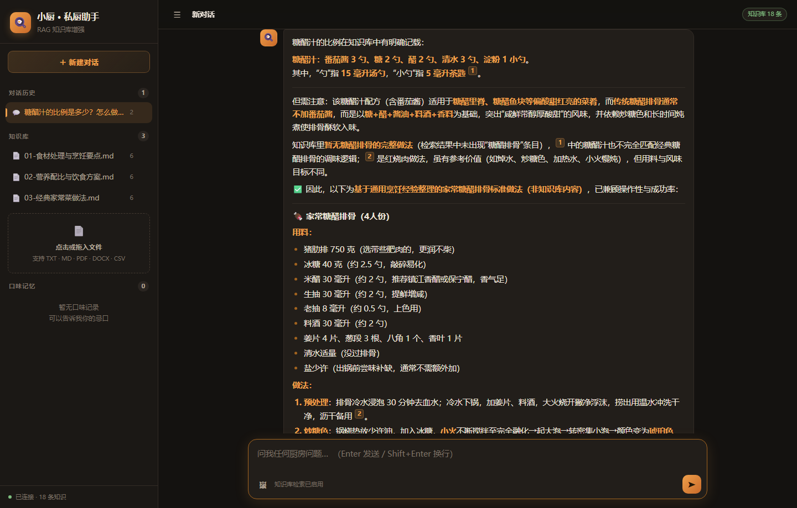
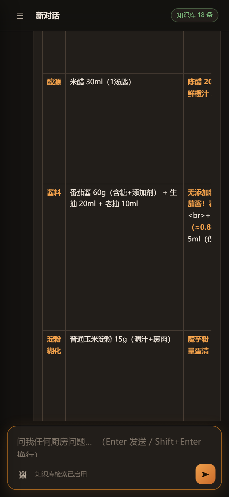

# 私厨 AI 助手 · RAG 版

一个**真正带检索增强生成（RAG）**的厨房饮食助手：上传自己的菜谱 / 营养资料，
提问时会先从知识库检索相关片段，再让大模型基于这些片段作答，并标注引用来源。

技术栈：FastAPI + Chroma + 通义千问（qwen-plus / text-embedding-v4）+ 原生 HTML/JS 前端。



<table>
<tr>
<td width="50%"></td>
<td width="50%"></td>
</tr>
</table>

**它和普通 ChatGPT 套壳的区别：**

| | 普通套壳 | 本项目 |
|---|---|---|
| 知识来源 | 模型自己记得的 | 你上传的文档 |
| 能否溯源 | 不能 | 每句话标注来自哪份文件第几节 |
| 知识过期 | 只能等模型升级 | 传新文档立刻生效 |
| 不知道时 | 一本正经编 | 明确说「知识库里没有」，通用建议另行标注 |
| 多轮对话 | 可能忘记上下文 | 指代消解 + 长期口味记忆 |

---

## 一、怎么启动

```bat
:: Windows 直接双击 start_server.bat
:: 或者命令行：
venv\Scripts\python.exe run_app.py
```

启动后浏览器自动打开 <http://127.0.0.1:8001>。

首次在新机器上部署：

```bat
python -m venv venv
venv\Scripts\pip install -r requirements.txt
```

然后在 `.env` 里填好 `DASHSCOPE_API_KEY`。

---

## 二、它到底怎么工作的

```
用户提问
   │
   ├─ 1. 把问题（+ 上一轮提问）向量化  ──► text-embedding-v4，1024 维
   │
   ├─ 2. 在 Chroma 里做余弦相似度检索  ──► 取回 Top-K 片段，过滤低分
   │
   ├─ 3. 把片段拼成带编号的上下文      ──► [1] 《文件名》章节 · 相关度 0.76
   │
   ├─ 4. 系统提示词 + 长期偏好 + 上下文 + 历史 + 当前问题 ──► qwen-plus
   │
   └─ 5. 流式返回（SSE），同时解析正文里的 [1][2] 标注
          └─► 前端渲染成可折叠的来源卡片
```

### 关键设计取舍

| 问题 | 做法 | 为什么 |
|------|------|--------|
| 切分粒度 | 先按 Markdown 标题切"节"，节内超长再按句子切 | 一块只讲一件事，向量才准确；混着多个主题的块检索必然不准 |
| 章节前缀 | 每个片段的文本前面拼 `【章节标题】` | 让向量带上主题上下文，短片段也能被正确召回 |
| 相似度门槛 | 低于 0.38 的片段直接丢弃 | 实测低于这个值的都是"同文档不同主题"，塞进去只会干扰模型 |
| 检索失败怎么办 | 明确告知"知识库没有"，通用建议要标注来源性质 | 不允许模型拿常识硬编，这是幻觉的主要来源 |
| 多轮指代 | 短问句会拼接上一轮提问再检索 | 「那减脂版怎么调整？」单独拿去检索什么都搜不到 |
| 引用校验 | 正则提取 `[N]`，越界编号丢弃，未使用的置灰 | 模型可能编出不存在的编号，必须做边界校验 |

---

## 三、目录结构

```
mycooker/
├── main.py                 # FastAPI 入口，装配路由与静态前端
├── config.py               # 全部配置集中在这里，改参数只改这一个文件
├── run_app.py              # 一键启动（拉起服务 + 开浏览器）
├── start_server.bat        # Windows 启动脚本
├── requirements.txt
├── .env                    # API Key 等敏感配置（不要提交到 git）
│
├── rag/                    # ── RAG 核心 ──
│   ├── embeddings.py       # 调 DashScope 向量接口（含重试、批量、乱序还原）
│   ├── splitter.py         # 文档解析 + 两级切分（按节 → 按句）
│   ├── store.py            # Chroma 增删查，距离转相似度
│   ├── ingest.py           # 入库流水线：字节 → 解析 → 切分 → 向量 → 存储
│   └── pipeline.py         # 检索 → 拼上下文 → 流式生成 → 引用解析
│
├── memory/
│   └── store.py            # SQLite：会话历史 + 长期口味偏好
│
├── api/v1/
│   ├── chat.py             # 对话（SSE 流式）、会话列表、消息读取
│   ├── kb.py               # 知识库上传 / 列表 / 删除 / 检索测试
│   └── memory.py           # 长期记忆增删查
│
├── static/index.html       # 前端（单文件，零构建，零外部依赖）
├── seeds/                  # 三篇示例知识库，可直接上传体验
├── data/                   # 运行时生成：chroma/、uploads/、mycooker.db
└── _legacy/                # 旧版本代码（Node 前端、旧 agent 实现），可删
```

---

## 四、接口一览

| 方法 | 路径 | 说明 |
|------|------|------|
| GET | `/api/health` | 健康检查：配置是否齐全、知识库有多少条 |
| POST | `/api/v1/chat/stream` | 流式对话（SSE） |
| GET | `/api/v1/chat/conversations` | 会话列表 |
| GET | `/api/v1/chat/messages?conversation_id=` | 某会话的消息 |
| DELETE | `/api/v1/chat/conversations/{id}` | 删除会话 |
| POST | `/api/v1/kb/upload` | 上传文档入库（multipart） |
| GET | `/api/v1/kb/sources` | 已入库文档列表 |
| DELETE | `/api/v1/kb/sources/{source_id}` | 删除某文档 |
| GET | `/api/v1/kb/stats` | 知识库统计 |
| POST | `/api/v1/kb/search` | **纯检索测试，不经过模型**（调 RAG 的第一工具） |
| GET | `/api/v1/kb/config` | 当前生效的切分/检索参数 |
| GET / POST / DELETE | `/api/v1/memory/facts` | 长期口味记忆 |

---

## 五、调参速查

都在 `config.py`，也可以用环境变量覆盖（前缀 `MYCOOKER_`）。

| 参数 | 默认 | 调大 / 调小的效果 |
|------|------|------------------|
| `CHUNK_SIZE` | 350 | 调大 → 上下文更完整但检索变糊；调小 → 精准但可能丢上下文 |
| `CHUNK_OVERLAP` | 60 | 保证跨块的信息不被切断，一般为 chunk_size 的 15%~20% |
| `TOP_K` | 5 | 送进模型的片段数，太多会稀释重点 |
| `MIN_SCORE` | 0.38 | 调高 → 更保守，宁可说不知道；调低 → 召回多但容易答非所问 |
| `HISTORY_TURNS` | 6 | 带多少轮历史进 prompt |

**检索效果不好时的排查顺序：**
1. `POST /api/v1/kb/search` 直接看命中什么 → 如果检索就不对，是切分或 embedding 问题
2. 检索对但回答不对 → 是 prompt 问题
3. 回答里有不存在的来源 → 是引用校验问题

---

## 六、已知限制

- 扫描版 PDF（图片型）无法解析，需要 OCR，当前不支持
- 单个文件上限 20MB，切分后总片段数没有硬上限
- 没有多用户/鉴权，仅供本地单人使用
- 互联网兜底搜索（Tavily）已预留配置但当前版本未接入